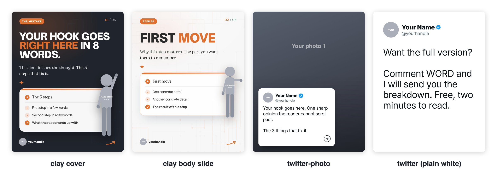
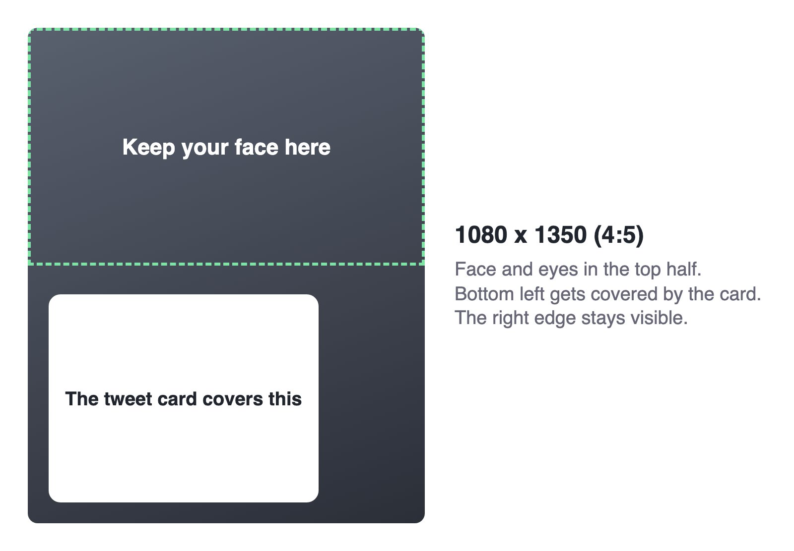
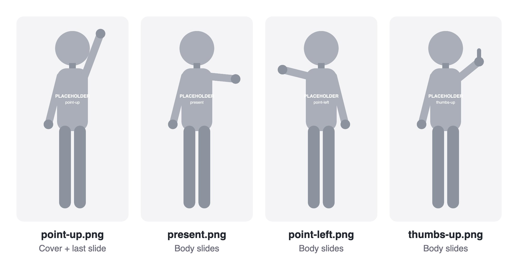
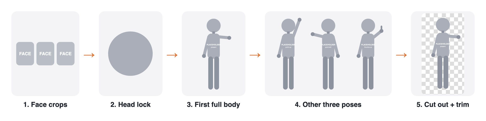

# Setup guide

Everything you need to swap in to make this kit yours: your details, your photos, your clay figure.



## 1. How the folders work

```text
carousel-kit/
├── assets/
│   ├── profile.js        ← your name, handle, colours (edit this)
│   ├── profile/
│   │   └── avatar.png    ← your real headshot
│   ├── photos/
│   │   ├── photo-1.jpg   ← photos behind tweet cards
│   │   ├── photo-2.jpg
│   │   └── photo-3.jpg
│   └── figure/
│       ├── point-up.png  ← your four clay poses
│       ├── present.png
│       ├── point-left.png
│       └── thumbs-up.png
├── template-clay.html    ← locked design, don't edit
├── template-tweet.html   ← locked design, don't edit
└── render.mjs            ← turns a deck into slide images
```

Only touch `assets/`. Replace each placeholder with a file of the same name and the templates pick it up.

Keep your working files outside the kit, so it stays small:

```text
my-carousels/
├── figure-source/
│   ├── 1-face-crops/     ← the photos you start from
│   ├── 2-head-lock/      ← the approved clay head (keep this safe)
│   ├── 3-poses-raw/      ← full-size poses on white
│   └── 4-cutouts/        ← finished PNGs, copied into assets/figure/
├── photo-originals/      ← full-size photos, before cropping
└── decks/
    └── 2026-11-03-topic/ ← one folder per carousel
        ├── deck.html     ← your copy of the template with the words filled in
        └── slides/       ← slide-01.jpg, slide-02.jpg, ready to post
```

Date-first folder names keep the decks in order. To reuse or fix a carousel, edit its `deck.html` and render it again.

## 2. Your details

Open `assets/profile.js` and fill in your name, handle, `brand` colour (the dark cover background) and `accent` colour (punch words and pills). Pick a `brand` dark enough for white text to read on it.

## 3. Your photos

These are used only by the `twitter-photo` and `tweet` styles. `clay` doesn't need them.



**What you need:**

- **Headshot:** one square photo, 256x256 or larger, saved as `assets/profile/avatar.png`. It stays small on the slides, so use a tight crop of your face.
- **Slide photos:** at least 3, cropped to 1080x1350, saved in `assets/photos/`. Three is enough because they repeat through a deck, but more makes decks look less alike.

**What works best:**

- You're the subject, looking at the camera or clearly doing your job.
- Your face is in the top half, because the card covers the bottom left.
- A simple background, with no other logos or small text.
- Sharp, well-lit photos from a phone or a shoot. No screenshots.

**Naming:** the sample decks use `photo-1.jpg` to `photo-3.jpg`. To add more, keep counting (`photo-4.jpg`), or use names that tell you what's in them (`on-stage.jpg`, `at-desk.jpg`). A slide picks its photo by filename:

```js
{ photo:'on-stage.jpg', text:'1) First point, in one plain sentence.' }
```

Only post photos you have the rights to. Check with your photographer if a professional took them.

## 4. Your clay figure

The `clay` style uses four poses of one character. You'll need all four before posting.



The grey figures above are placeholders. Yours replace them with the same filenames.

### What you need

- **3 to 5 clear photos of your face:** front on, good light, tight crops, no sunglasses. A wider shot also helps with hair and build.
- **Your outfit, in words:** for example "navy blazer, white tee, dark jeans, white sneakers".
- **Your face, in words:** face shape, cheekbones, chin, brows, eye shape and colour, smile, exact hair colour. This list is what gets the likeness right.
- **An image model that takes reference images.** The original figures were made on Higgsfield with `nano_banana_pro` at 2:3, 2k.
- **For cutting out the background:** `uv` (runs `rembg` without an install).

### Steps



**1. Make the head first.** Give the model only your face crops. Do not use another clay figure as a style reference: that gave a generic face that looked nothing like the person.

> Stylized 3D clay head-and-shoulders bust of the person in the reference photos. Polished claymation collectible, soft matte clay with subtle fingerprint marks. Mild stylization: keep their real facial proportions, do not round the face, do not enlarge the eyes. [YOUR FACE LIST]. Studio lighting, plain pure white background, no text, no logo, no props.

Repeat until it looks like you. This approved head is your **head lock**. Everything else depends on it.

**2. Make the first full body.** Image 1 = head lock, image 2 = your best face crop.

> The SAME person as image 1, as a full-body 3D clay figurine, tall slim natural proportions, normal-sized head, NOT chibi. Soft matte clay, rounded simplified hands. Outfit: [YOUR OUTFIT]. Standing, one open hand presenting to the side. Head to toe fully visible, studio lighting, soft shadows, plain pure white background, centered, nothing cropped. No text, no logo, no props.

Save it as your **present** pose.

**3. Make the other three poses.** Image 1 = head lock, image 2 = the present pose.

> The SAME figure in every way, identical tall slim proportions, normal-sized head, NOT chibi. [POSE: one arm pointing straight up / pointing to the left / giving a thumbs up]. Head to toe fully visible, plain pure white background, nothing cropped.

Line all four up side by side before going further. Bodies drifting short and big-headed between poses is the usual failure. Regenerate any that don't match.

**4. Cut out the backgrounds.**

```bash
uvx --python 3.12 --with onnxruntime --from 'rembg[cli]' rembg p -m isnet-general-use ./3-poses-raw ./4-cutouts
```

`rembg` can eat white clothing and teeth, leaving holes. If it does, fill the figure's silhouette solid and keep the soft cutout only in a 3 px band around the edge. Then trim the empty space and scale to about 1400 px tall.

**5. Drop them in.** Copy the finished PNGs into `assets/figure/` using the four filenames above.

## 5. Test it

```bash
cd ~/.claude/skills/carousel-kit && node render.mjs clay /tmp/clay-test && open /tmp/clay-test/*.jpg
```

Check that the figure never covers text, that all the poses read as the same character, and that no grey placeholder is left. Then run `/carousel-kit clay <your topic>`.
